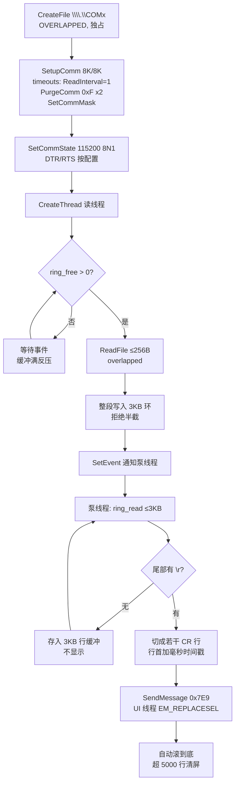

# QCOM 串口原始日志行为规格（供 NearLink LinkScope 参考）

> 分析对象：`E:\Starklink\QCOM_V1.6.exe`（PE32 x86，MFC，389,120 B，版本 1.6.0.2，无签名）
> SHA-256：`18be3fd4712e8ef44cbfe379fce1fa4154f6b0f236d83076d87af92039ebd92e`
> 方法：REA（Ghidra 12.1.4 provider）静态反编译 + Ghidra headless 补建线程体函数 + 字符串/字节扫描 + 日志文件实证
> 目的：仅提取可观察行为与通用实现方式，不复制源码，不涉及授权绕过。

标注约定：**【已证实】** = 反编译/字节/日志直接证明；**【推断】** = 由多处证据合理外推；**【未确认】** = 证据不足。

---

## 0. 一句话结论

**QCOM 的原始窗口不做任何"理解"：接收线程只负责把字节搬进 3 KB 环形缓冲，另一个线程按 `\r` 切行，切出一行就立刻 `SendMessage` 追加到 RichEdit。没有 boot 关键字、没有 ready 门控、没有协议解析、没有行数丢弃策略，只有"行缓冲满 3 KB 时丢弃后续字节"这一个硬边界。** 统计/发送/日志都是旁路，不参与显示决策。

---

## 1. 打开串口参数

### 1.1 配置来源与映射

| Config.ini 键 | 值 | 映射代码 | 实际 DCB 值 |
|---|---|---|---|
| ComPort | 1 | 格式化 `\\.\COM%d` | COM1 |
| Baudrate | 5 | `FUN_004078B0` switch 表 | 0x1C200 = **115200** |
| ByteSize | 4 | `FUN_00407830`：`值 = index + 4` | **8** |
| StopBits | 0 | `FUN_00407860` 直通 | **ONESTOPBIT (1 位)** |
| Parity | 0 | `FUN_00407970` 直通 | **NOPARITY** |
| FlowCtrl | 0 | `FUN_004017E0` 分支 0 | **无流控** |
| DTR_Enable | 0 | `flags=(flags & 0xFFFFFFC5) \| 1` | **DTR_CONTROL_DISABLE** |
| RTS_Enable | 0 | `flags &= 0xFFFFCFBB` | **RTS_CONTROL_DISABLE** |

波特率表（`FUN_004078B0`，index → baud）：
`0=4800, 1=9600, 2=19200, 3=38400, 4=57600, 5=115200, 6=230400, 7=460800, 8=921600` 【已证实】

### 1.2 打开调用

```
CreateFileA("\\.\COM%d", GENERIC_READ|GENERIC_WRITE, 0, NULL,
            OPEN_EXISTING, FILE_FLAG_OVERLAPPED|FILE_ATTRIBUTE_NORMAL, NULL)
```
- `0xC0000000` = GENERIC_READ|WRITE，`0x40000080` = FILE_FLAG_OVERLAPPED | FILE_ATTRIBUTE_NORMAL 【已证实】
- 共享模式 = 0（独占），因此**同一个 COM 只能有一个句柄** 【已证实】
- 已打开保护：`FUN_00401060` 开头 `if (*(comm+0x18A8)+0x3C != -1) return 1;` 【已证实】

### 1.3 超时与缓冲

```
COMMTIMEOUTS t = { ReadIntervalTimeout=1, ReadTotalTimeoutMultiplier=0,
                   ReadTotalTimeoutConstant=0, WriteTotalTimeoutMultiplier=0,
                   WriteTotalTimeoutConstant=0 };
SetupComm(h, 0x2000, 0x2000);      // 驱动层 8 KB 收 / 8 KB 发
PurgeComm(h, 0xF);                 // PURGE_TXABORT|RXABORT|TXCLEAR|RXCLEAR —— 打开后清两次
SetCommMask(h, 0x1FD);             // 打开阶段用全事件掩码
PurgeComm(h, 0xF);                 // 中间夹一次 SetCommMask
```
- `ReadIntervalTimeout=1` 意味着：**只要线上出现 1 ms 空隙，ReadFile 立刻带着已有的几个字节返回**，不与"行"对齐 【已证实】
- 读线程随后把事件掩码改为 `0x1F9`（RXCHAR|CTS|DSR|RLSD|BREAK|ERR|RING）【已证实】
- 打开时**只 Purge，不主动 flush 后续数据**；DTR/RTS 只按配置设置，不做脉冲复位 【已证实】

---

## 2. 接收实现

### 2.1 线程模型（三段解耦）

```
[读线程 FUN_00401480]  --字节-->  [3KB 环形缓冲 comm+0x60]
                                        |
                                        v
                          [泵线程 FUN_004021C0]  --按 \r 切行-->  SendMessage(0x7E9)
                                        |
                                        v
                             [UI 线程] FUN_00407EE0 -> RichEdit
```
- 读线程与泵线程都是 `CreateThread` 创建的独立线程；写线程 `FUN_00401720` 再独立一个 【已证实】
- UI 更新用 **`SendMessageA`（同步）**，不是 `PostMessage`；UI 忙时泵线程会被阻塞，形成反压 【已证实】
- 收发完全解耦：写线程不碰接收缓冲 【已证实】

### 2.2 读线程

```
SetCommMask(h, 0x1F9);
stop = 0;
loop:
  if stop: break
  free = ring_free(recv)                 // FUN_00401930
  if free < 1: wait; continue            // 缓冲满 -> 不读
  n = min(free, 0x100)                   // 每次最多 256 字节
  ReadFile(h, buf, n, &got, &ov)         // overlapped
  若完成且 got>0: ring_append(recv, buf, got); notify()   // FUN_00401960 / FUN_004019E0
  否则: GetOverlappedResult 取字节
  等待: WaitForMultipleObjects(4, {killRead, hReadEvent, hCommEvent, hWriteEvent})
  通信事件: ClearCommError + 处理 CTS/DSR/RLSD/BREAK
```
- 每次读 **≤ 256 字节**（`0x100`）【已证实】
- 环缓冲容量 **0xC00 = 3072 字节**（`FUN_004018D0`）【已证实】
- 环缓冲写入是"整段或拒绝"：`FUN_00401960` 在 `len >= free` 时返回 -1，不写半截 → **不会撕裂数据，只会让读线程等** 【已证实】

### 2.3 泵线程（行切分，核心）

```
loop:
  n = ring_read(recv, buf, 0xC00)        // FUN_00402080，顺带 SetEvent 唤醒读线程
  if n == 0: return
  p = n-1
  while p >= 0 and buf[p] != '\r': p--   // 从尾部找最后一个 CR
  if p >= 0:
      append buf[0..p] (含 CR) 到行缓冲 dialog+0x28E4，len += p+1
      sprintf(dialog+0x28BD, "[%04d-%02d-%02d_%02d:%02d:%02d:%03d]", ...)   // FUN_00402D20
      SendMessage(hwnd, 0x7E9, dialog+0x28E4, len)     // FUN_004023F0
      len = 0
      把 buf[p+1..n-1] 作为下一行开头
  else:
      append min(n, 0xC00-len) 到行缓冲       // 不显示
      // 行缓冲满（len==0xC00）后，新字节被"追加 0 字节"丢弃，但仍继续循环
```
- **显示严格以 `\r`（CR）为界**，不是 `\n`，也不是超时 【已证实】
- 无 CR 的尾部数据**滞留在 3 KB 行缓冲里不显示**，直到下一个 CR 到达 【已证实】
- 行缓冲超 3 KB 且仍无 CR：超出部分被丢弃，且没有任何提示 【已证实】
- 超时返回的半行：`ReadFile` 会立刻返回几字节，但泵线程不因"超时"而 flush，仍然等 CR 【已证实】

### 2.4 队列与丢弃策略

| 层 | 容量 | 满时行为 |
|---|---|---|
| 驱动 RX 缓冲 | 8 KB（SetupComm） | 驱动丢字节（不可控） |
| 应用环形缓冲 | 3 KB | 读线程停读（反压），不丢 |
| 行缓冲 | 3 KB | 无 CR 时丢弃溢出字节（**唯一应用层丢点**） |
| RichEdit | 5000 行 | 超过后整框清空（`FUN_00410AC0`） |

### 2.5 编码处理

- 控件是 ANSI RichEdit，`SendMessageA(EM_REPLACESEL, ptr)` 直接贴字节 → 由系统代码页（本机 936/GBK）解释 【已证实】
- 无效字节不会崩溃，显示为方框/替换字符；日志文件里按 GBK 存储，实测可正常解码 【已证实】
- 不做 UTF-8 探测、不做 BOM 判断 【已证实】

---

## 3. 原始日志显示

### 3.1 是否过滤

**没有。** 证据：
- 全文串扫描 `boot` / `ready` / `ready.` / `init` 等关键字，接收路径无任何比较分支；命中的 "Ready" 是 MFC 状态栏常量（0x460E12）【已证实】
- 泵线程与 0x7E9 处理函数内只有 `\r`/`\n` 判断和显示模式分支，没有内容判断 【已证实】
- 实测日志从 `boot.` 到 `Flash Init Fail!` 到 `verify_*` 全部保留 【已证实】

### 3.2 是否从第一个字节开始

- 打开串口 → `PurgeComm(0xF)` 清掉**打开瞬间之前**残留的驱动缓冲；之后到达的字节全部进入读线程 【已证实】
- 不存在"等 boot 再显示"逻辑；第一条 CR 行到达即显示 【已证实】

### 3.3 时间戳

- 格式串唯一：`[%04d-%02d-%02d_%02d:%02d:%02d:%03d]`（毫秒，0x450370），全 exe 仅此一处 【已证实】
- 生成函数 `FUN_00402D20`，调用点仅 3 处：泵线程（0x402291）、raw 回调（0x402371）、状态行处理器（0x412454）【已证实】
- **落盘文件证明每行行首带毫秒时间戳，且行文本尾部带 `\r`**：
  `[2026-11-06_19:52:54:767]boot.\r` + `\r\n` 【已证实】
- 屏幕上时间戳与行文本的拼接点：泵线程把时间戳写在 `dialog+0x28BD`、行文本写在紧随其后的 `dialog+0x28E4`（相距 0x27 字节），HEX 模式显示函数直接从 `dialog+0x28BD` 起贴字符串。**【推断】显示行与落盘行同源、都含时间戳**；文本模式分支的 `EM_REPLACESEL` 未见单独插入时间戳，两个时间戳缓冲的确切拼接方式 **【未确认】**。

### 3.4 显示模式

- `dialog+0x28DD` = 模式开关：0 文本模式，1 HEX 模式 【已证实】
- 文本面板：`+0x4F0`（HWND `+0x50C`）【已证实】
- HEX 面板：`+0x7C`（HWND `+0x98`）【已证实】
- 文本模式：整块原始字节原样贴文本面板；同时按 500 字节切块转 `"%02X "` 贴 HEX 面板 【已证实】
- HEX 模式：逐字节 `0xNN` 拼行，每行最多 499 字符或遇 CR/LF 强制断行；每行行首贴时间戳 + CRLF(0x450504) 【已证实】

### 3.5 滚动与限流

- 每块追加后把光标 `SetSel` 到末尾，`LineScroll` 到最后一行（自动滚动），无"暂停滚动"逻辑 【已证实】
- `EM_GETLINECOUNT > 4999` 时，`SetWindowText("")` 直接清空文本面板（另一次调用清 HEX 面板）——**不是截断旧行，而是整体清屏** 【已证实】
- 除此之外没有任何节流、合并、抽样 【已证实】

---

## 4. 生命周期

### 4.1 关闭

```
FUN_00401F20:
  SetEvent(killWrite=+0x48); SetEvent(killRead=+0x4C);
  WaitForMultipleObjects(2, {readThread, writeThread}, TRUE, 8000);  // 最长等 8 s
  CloseHandle(全部 5 个事件 + 串口句柄 + 线程句柄);
  Buffer_Destroy(recv); Buffer_Destroy(send);
  handle = -1;
```
- **快速关→开**：`FUN_00401F20` 会等旧线程退出（上限 8 s），随后才允许 `CreateFileA`；未等到会继续往下关并置 -1，但句柄关闭后旧线程的 ReadFile 会失败退出 【已证实 + 推断】
- 关闭不清空 RichEdit 内容，日志保留在控件里 【已证实】
- 没有"USB 拔出"专用处理：读线程 `ReadFile` 失败即 `stop=1` 退出，UI 只收到 `Open %s Failed, Error:%08x` 类状态串；**不自动重连** 【已证实】

### 4.2 多窗口

- 对话框持有一个 `CComm` 对象（`dialog+0x34F4`），打开时用"已打开则返回"保护 【已证实】
- 多面板（A 板/B 板、文本/HEX）共享同一份数据，不是各自开句柄 【推断，基于单 CComm + 单泵】

---

## 5. 保存日志

- 触发：`Enable_Save_Log != 0`（`dialog+0x2638`）时，在每次 0x7E9 显示之后调 `FUN_004124C0` 【已证实】
- 写入内容：**从 RichEdit 控件逐行 `EM_GETLINE` 取出的"显示后文本"**，经日志对象虚函数 `+0x54` 写入 【已证实】
- 因此：
  - 保存的是**解码后的文本**（ANSI/GBK），不是原始字节 【已证实】
  - **时间戳已包含在行文本里**（落盘实测）【已证实】
  - 行尾的 `\r` 也一起写入 → 文件里出现 `<0D><0D><0A>` 的"空行" 【已证实】
  - 乱码、异常行、不完整行（只要有 CR 触发显示）都保留 【已证实】
- 文件路径：`<LogPath>\QCOM_LOG.txt`（目录已带 `\` 时用 `%sQCOM_LOG.txt`），打开失败弹 "Open LOG File Error!"（0x450730）【已证实】

---

## 6. 最小接收流程



---

## 7. Python + pyserial + Tkinter 行为规格

### 7.1 必须复刻的行为

| 编号 | 行为 | QCOM 依据 |
|---|---|---|
| B1 | 打开即独占，参数 115200/8/N/1，无流控，DTR/RTS 默认关 | §1 |
| B2 | 打开后清空驱动缓冲（`reset_input_buffer()`），之后到来的字节全收 | PurgeComm ×2 |
| B3 | 读线程与 UI 线程分离，读线程只入队，绝不碰 Tk | §2.1 |
| B4 | 队列容量有限（建议 ≥ 64 KB，比 QCOM 的 3 KB 宽），满时读线程等，不丢 | 3 KB 环 + 反压 |
| B5 | 显示以 `\r` 为行界；无 CR 的尾段留在行缓冲，超过上限才丢 | §2.3 |
| B6 | 无任何内容过滤（不判 boot./ready/平台签名） | §3.1 |
| B7 | 每显示行行首加 `[YYYY-MM-DD_HH:MM:SS:mmm]` | §3.3 |
| B8 | 保存日志 = 显示行原文（含时间戳），不是原始字节 | §5 |
| B9 | 关闭时先停读线程并 join（QCOM 8 s，建议 2 s），再 close | §4.1 |

### 7.2 与你的 5 条需求的差异（重要）

| 你的要求 | QCOM 实际 | 建议 |
|---|---|---|
| 1. 打开后立即显示全部原始日志 | 只在 CR 到达时显示；无 CR 的启动乱码会滞留 | 若要"立即"，需额外加"超时 flush"（QCOM 没有） |
| 2. 不等待 boot./ready | ✅ 完全符合，确实没有任何门控 | 直接照做 |
| 3. 乱码/半行/NMI/重启都不能隐藏 | 乱码保留；**半行在有 CR 前不显示**；>3 KB 无 CR 丢尾 | 保留 CR 分行的同时，加 200–500 ms 空闲 flush |
| 4. 统计解析独立支路 | ✅ 解析器完全旁路，显示不等解析 | 照做，用独立队列 + 独立线程 |
| 5. 每端口单句柄 | ✅ 独占打开 + 已打开保护 | 照做 |

### 7.3 参考骨架（行为等价，非源码复制）

```python
import queue, threading, time, datetime
import serial

class Reader(threading.Thread):
    """只负责把字节搬进队列；绝不碰 UI。"""
    def __init__(self, port, q, stop):
        super().__init__(daemon=True)
        self.port, self.q, self.stop = port, q, stop

    def run(self):
        buf = bytearray()
        while not self.stop.is_set():
            try:
                chunk = self.port.read(256)          # 对应 ReadFile ≤256B
            except serial.SerialException:
                self.q.put(("error", "port closed")); return
            if not chunk:
                continue
            buf += chunk
            # 以 \r 为界切行（QCOM 语义）；\n 不参与分行
            while True:
                i = buf.find(b"\r")
                if i < 0:
                    break
                line, buf = bytes(buf[: i + 1]), buf[i + 1 :]
                self.q.put(("line", line))
            if len(buf) > 64 * 1024:                 # 行缓冲硬上限（比 QCOM 宽）
                self.q.put(("line", bytes(buf)))     # 宁可显示也不静默丢
                buf.clear()

class App:
    def __init__(self, port_name):
        self.q = queue.Queue(maxsize=4096)
        self.stop = threading.Event()
        self.ser = serial.Serial(port_name, 115200, bytesize=8, parity="N",
                                 stopbits=1, timeout=0.05, xonxoff=False,
                                 rtscts=False, dsrdtr=False)
        self.ser.dtr = False
        self.ser.rts = False
        self.ser.reset_input_buffer()                # 对应 PurgeComm
        self.reader = Reader(self.ser, self.q, self.stop)
        self.reader.start()
        self.after(20, self.pump)

    def pump(self):
        """UI 线程：一次最多取 N 行，避免长任务卡死界面。"""
        for _ in range(400):
            try:
                kind, payload = self.q.get_nowait()
            except queue.Empty:
                break
            if kind == "line":
                self.append_line(payload)
        self.after(20, self.pump)

    def append_line(self, raw: bytes):
        ts = datetime.datetime.now().strftime("[%Y-%m-%d_%H:%M:%S:") \
             + f"{datetime.datetime.now().microsecond // 1000:03d}]"
        text = raw.decode("gbk", errors="replace")   # 与 QCOM 一致：按系统代码页
        self.text.configure(state="normal")
        self.text.insert("end", ts + text + "\n")
        self.text.configure(state="disabled")
        if int(self.text.index("end-1c").split(".")[0]) > 5000:
            self.text.delete("1.0", "end")           # 对应 SetWindowText("")
        self.text.see("end")
```

要点：
- `timeout=0.05` 对应 QCOM 的 `ReadIntervalTimeout=1`（有数据立刻返回）。
- `pump()` 在 Tk 主线程跑，靠 `after` 轮询队列实现"显示与读解耦"。
- 若要"半行不隐藏"，在 `Reader` 里加一个"最后字节时间戳"，空闲 300 ms 就把 `buf` 当作一行发出——这是 QCOM 没有、但你需要的增强。

---

## 8. 证据清单（函数地址）

| 地址 | 作用 |
|---|---|
| 0x401060 | 打开串口、timeouts、SetupComm、Purge、建线程 |
| 0x4017E0 | DCB 设置（DTR/RTS/流控/校验/停止位） |
| 0x401480 | 读线程（overlapped ReadFile ≤256B） |
| 0x401720 | 写线程 |
| 0x4018D0/0x401930/0x401960 | 环形缓冲初始化/剩余空间/整段写入 |
| 0x401F20 | 关闭：kill 事件 + join 8 s + 释放 |
| 0x4021C0 | 泵线程：取环、找 CR、打时间戳、投递 0x7E9 |
| 0x402340 | raw 数据回调（另一条直通显示路径） |
| 0x4023F0 | SendMessageA(hwnd, 0x7E9) |
| 0x402D20 | 时间戳格式化（唯一格式串 0x450370） |
| 0x407EE0 | 0x7E9 处理：文本/HEX 双面板追加、限行、保存日志 |
| 0x407B50 | Config.ini 默认值加载 |
| 0x4078B0 | 波特率 index→baud 表 |
| 0x407830 | ByteSize = index + 4 |
| 0x407860 / 0x407970 | StopBits / Parity 直通映射 |
| 0x408D60 | 开/关串口入口 |
| 0x40ECC0 | 日志路径拼接 |
| 0x4124C0 | 从控件逐行取文本写日志 |
| 0x412550 | 日志开关/打开失败提示 |

---

## 9. 未确认项

1. 文本面板显示行与 `dialog+0x28BD` 时间戳的精确拼接路径（落盘已证明含时间戳，但文本分支 `EM_REPLACESEL` 本身未见插入动作）——不影响规格结论。
2. USB 拔出后旧线程退出的确切时序（读线程置 stop、UI 收到错误串，但未验证是否自动尝试重开）。
3. A 板/B 板多面板是否共用同一 CComm（代码结构指向"是"，未运行验证）。
